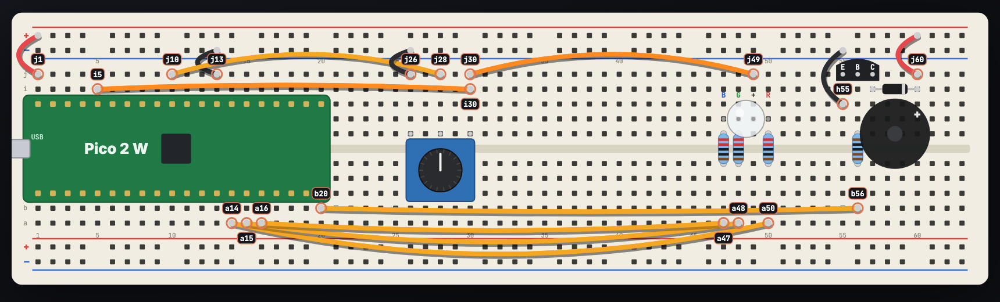

# Project 3 wiring

Project 3 uses exactly the same board as project 2: **no wiring changes**.
Step-by-step build: [project 2 assembly guide](../../project-2/docs/assembly.md).

Columns run 1–63 left to right; row **a** is nearest you. The top (far) rails
are the ones used: red = 5 V, blue = ground.

| Wire | Colour | From → to | Job |
|-----:|--------|-----------|-----|
| 1 | red | j1 → top red rail | Pico VBUS: 5 V from USB |
| 2 | black | j13 → top blue rail | Pico GND: ground |
| 3 | orange | i5 → i30 | Pico 3V3 to the knob's right leg |
| 4 | yellow | j10 → j28 | knob's middle leg to GP26 (reads the knob) |
| 5 | black | j26 → top blue rail | knob's left leg to ground |
| 6 | orange | j30 → j49 | 3.3 V on to the RGB LED's longest leg |
| 7 | yellow | a14 → a50 | GP10 → red |
| 8 | yellow | a15 → a48 | GP11 → green |
| 9 | yellow | a16 → a47 | GP12 → blue |
| 10 | black | h55 → top blue rail | transistor emitter to ground |
| 11 | red | j60 → top red rail | 5 V to the buzzer's + leg |
| 12 | yellow | b20 → b56 | GP15 to the 1 kΩ resistor (plays the buzzer) |

Parts: knob in f26 f28 f30; RGB LED in g47 g48 **g49 (longest leg)** g50;
220 Ω resistors f47→e47, f48→e48, f50→e50; 1 kΩ resistor f56→e56;
transistor in j55 j56 j57 (flat side toward you); buzzer − f57, + f60;
diode i57 → i60 with the **band on i60**.

**What connects to what:**
- **5 V:** Pico VBUS – Wire 1 – top red rail – Wire 11 – buzzer + – diode band
- **3.3 V:** Pico 3V3 – Wire 3 – knob right leg – Wire 6 – RGB longest leg
- **Ground:** Pico GND – Wire 2 – top blue rail – Wire 5 (knob) and Wire 10 (transistor)
- **Red/green/blue:** GP10/GP11/GP12 – Wires 7/8/9 – 220 Ω – RGB legs
- **Knob reading:** knob middle leg – Wire 4 – GP26
- **Buzzer:** GP15 – Wire 12 – 1 kΩ – transistor; transistor – buzzer − – diode plain end

Before plugging in: nothing in **i4, j4, i11 or j11** (those pins switch off
or reset the Pico), and the diode band is on **i60**.
